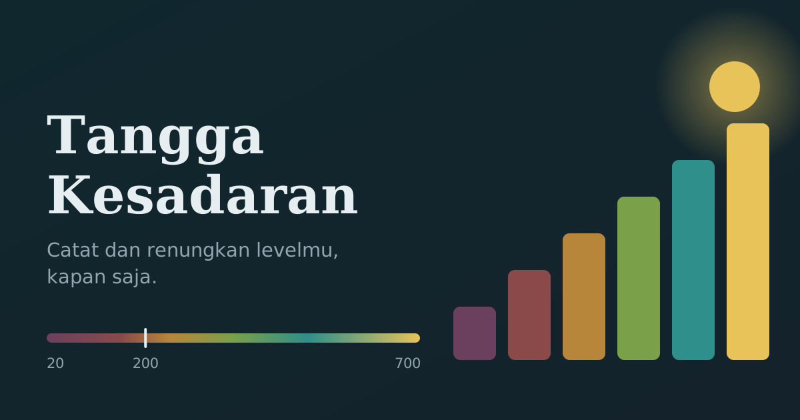

# Tangga Kesadaran



Aplikasi web sederhana untuk mencatat dan merenungkan level kesadaran berdasarkan **Map of Consciousness** David R. Hawkins. Satu file HTML, tanpa build, tanpa server, siap dipasang di GitHub Pages. Data tersimpan di browser penggunanya.

> **Catatan penting:** aplikasi ini alat refleksi diri berdasarkan penilaian jujurmu sendiri. Ia bukan kalibrasi kinesiologi ala Hawkins dan bukan alat diagnosis. Angka adalah cermin, bukan nilai dirimu.

## Fitur

- **Tes**: 17 pernyataan acak, satu per level (Malu 20 sampai Pencerahan 700). Hasilnya skor tertimbang, level yang paling terasa, posisi di spektrum, saran naik selangkah, dan kalimat renungan.
- **Catat langsung**: pilih level kapan saja, termasuk untuk waktu lampau, dengan kolom pemicu, refleksi, dan langkah kecil berikutnya.
- **Riwayat**: semua entri bisa dibuka, diedit, dan dihapus.
- **Grafik & insight**: grafik tren (7, 30, 90 hari, atau semua), sebaran level, dan insight otomatis seperti rata-rata, tren, stabilitas, waktu terbaik dalam sehari, dan kata berulang di pemicu.
- **Kalibrasi & data**: perbarui bank soal, tambah soal sendiri, cek bias penilaian, serta ekspor dan impor JSON atau CSV.
- **Tabel level**: emosi, pandangan hidup, dan saran naik level.

## Struktur repo

```
.
├── index.html                     # seluruh aplikasi
├── soal.json                      # soal tambahan (opsional, dibaca tombol "Perbarui soal")
├── manifest.webmanifest           # agar bisa ditambahkan ke layar utama HP
├── assets/                        # ikon dan gambar pratinjau
│   ├── icon.svg
│   ├── icon-192.png / icon-512.png / icon-maskable-512.png
│   ├── apple-touch-icon.png
│   └── og-image.png / og-image.svg
├── scripts/
│   └── generate_soal.py           # pembuat soal baru lewat Claude API
└── .github/workflows/
    └── update-soal.yml            # jadwal mingguan untuk skrip di atas
```

Hanya `index.html` yang wajib. File lain bersifat opsional.

**Pratinjau tautan:** di `index.html`, ganti `USERNAME` dan `NAMA-REPO` pada tag `og:image` dengan alamat GitHub Pages-mu agar gambar muncul saat tautan dibagikan di WhatsApp atau media sosial.

## Deploy ke GitHub Pages

1. Buat repository baru dan unggah semua file di atas sesuai strukturnya.
2. Buka **Settings**, lalu **Pages**.
3. Pada Source pilih **Deploy from a branch**, branch `main`, folder `/ (root)`, lalu **Save**.
4. Tunggu sekitar satu menit, lalu buka `https://<username>.github.io/<nama-repo>/`.

## Cara kerja tes

Setiap pernyataan dinilai seberapa benar untukmu **saat ini**:

| Nilai | Label | Arti |
|---|---|---|
| 0 | Tidak sama sekali | Bukan aku |
| 1 | Sedikit benar | Sesekali terasa |
| 2 | Cukup benar | Kadang terasa |
| 3 | Sangat benar | Sering terasa |
| 4 | Persis aku | Itulah yang kurasakan sekarang |

Skor akhir adalah rata-rata nilai level yang dibobot dengan jawabanmu: `skor = Σ(nilai jawaban × nilai level) / Σ(nilai jawaban)`. Level "paling terasa" adalah level dengan jawaban tertinggi; jika seri, diambil level yang lebih rendah.

Tiap level punya beberapa variasi kalimat. Setiap tes memilih satu variasi yang belum keluar, sehingga soal tidak mudah dihafal. Skor dihitung per level, jadi hasil antar tanggal tetap sebanding.

## Data dan privasi

- Semua catatan disimpan di **localStorage** browser (kunci `hawkins.entries.v1`). Tidak ada data yang dikirim ke server.
- Data tidak tersinkron antar perangkat dan hilang jika data situs dibersihkan. **Ekspor JSON secara berkala** dari tab Kalibrasi & data.
- Untuk memindahkan data, ekspor di perangkat lama lalu impor di perangkat baru. Entri yang sudah ada tidak ditimpa.
- Ekspor CSV berisi waktu, skor, mode, pemicu, refleksi, dan langkah.

## Memperbarui soal

### Lewat `soal.json`

Format: kunci adalah nilai level, nilainya daftar kalimat.

```json
{
  "20": ["Aku ingin menyembunyikan kekuranganku karena takut dinilai."],
  "200": ["Aku berhenti mencari kambing hitam dan mulai bertanya apa bagianku."]
}
```

Edit file ini di GitHub, lalu tekan **Perbarui soal** di tab Kalibrasi & data. Soal baru ditambahkan ke bank soal di perangkat itu tanpa menghapus yang lama. Tombol ini hanya bekerja lewat alamat GitHub Pages, bukan dari file lokal.

### Otomatis dengan GitHub Action

Workflow `update-soal.yml` berjalan tiap Minggu pukul 20:00 UTC (Senin 03:00 WIB) dan bisa dijalankan manual dari tab **Actions**. Ia meminta Claude menulis 2 pernyataan baru per level, lalu menyimpannya ke `soal.json`.

Pemasangan:

1. Buka **Settings**, **Secrets and variables**, **Actions**, lalu **New repository secret**.
2. Isi nama `ANTHROPIC_API_KEY` dan nilai kunci API dari console.anthropic.com.
3. Buka tab **Actions**, pilih **Update soal**, lalu **Run workflow** untuk mencoba.

Pengaturan opsional lewat variabel lingkungan di skrip:

| Variabel | Bawaan | Fungsi |
|---|---|---|
| `SOAL_PER_LEVEL` | `2` | Jumlah soal baru per level tiap kali jalan |
| `SOAL_MAX_PER_LEVEL` | `40` | Batas soal tambahan per level |
| `SOAL_MODEL` | `claude-sonnet-5-5` | Model yang dipakai |

Soal hasil otomatis langsung masuk ke `soal.json` tanpa tinjauan. Baca isinya sesekali dan hapus kalimat yang janggal. Kunci API hanya tersimpan di secret GitHub dan tidak pernah masuk ke halaman aplikasi.

## Kustomisasi

Semua konten ada di bagian `<script>` pada `index.html`:

- `L`: tabel level (nilai, emosi, proses, pandangan hidup, pernyataan utama, saran naik level).
- `QB`: variasi pernyataan tambahan per level.
- `RF`: kalimat renungan per level.
- `SC`: label lima pilihan jawaban.

## Lisensi dan atribusi

Kerangka level berasal dari buku *Power vs. Force* karya David R. Hawkins. Seluruh pernyataan, renungan, dan saran dalam aplikasi ini adalah tulisan orisinal untuk keperluan refleksi pribadi.
